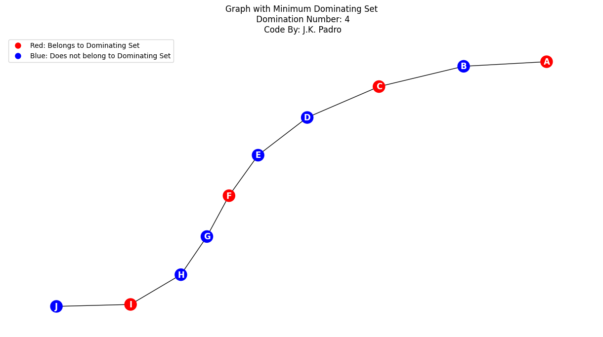

<h1 style="text-align:center;">Domination Number of a Graph using Python</h1>
<h3 style="text-align:center;">By: John Kevin M. Padro</h3>

This output presents the code that determines the domination number of a given graph using Python Programming and it will also plot the graph that will visualize a domination graph

